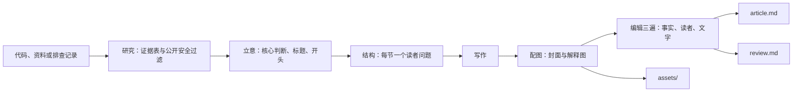

# 架构与设计选择

ai-knowledge 是由宿主 Agent 执行的指令包，没有独立生成进程、模型 API、数据库或后台服务。只安装 `skills/ai-knowledge/` 即可工作。

研究产出的证据表原样进入 review.md；article.md 只承载要发表的正文。两者从同一份研究派生，但读者不同，所以分成两个文件。

## 为什么从三稿改成一篇文章

v0.1.0–v0.3.0 每个主题交付知识笔记、发布文章和复习卡片三份稿件。实际使用中暴露了三个问题：

- 精力被三份稿件摊薄，发布文章只是其中之一，质量上限受限于"一次写三份"。
- 核验日期、草稿状态、审批说明混进了正文，复制到平台前要手工删除。
- 证据表留在笔记里，没有固定格式，独立复查无从下手。

v0.4.0 只交付一篇可以直接发表的 article.md，把所有生产信息集中到 review.md，并要求证据表使用固定表头和核验状态。写稿者自己整理的结论只能标"未核验"，留给新会话、子 Agent 或作者本人复查。

## 资源职责

| 文件 | 职责 | 加载时机 |
| --- | --- | --- |
| SKILL.md | 八步流程、模式选择、优先级与安全边界 | 命中技能时 |
| publishing.md | 目录与文件合同、两份 frontmatter、review.md 固定章节、平台改编、封面比例 | 写入与交付时 |
| writing-craft.md | 核心判断、标题、开头、结构、段落、代码、结尾 | 立意与写作时 |
| editing.md | 三遍编辑、阻断项、公开安全过滤、独立复查 | 写完正文后 |
| feature-analysis.md / concept-explanation.md / problem-review.md | 各模式的证据收集方法，以及从研究到文章的转换 | 对应模式 |
| visual-brand-loading.md | 品牌选择、关闭、替换与回退 | 配图时（默认） |
| visual-planning.md | 选图、版式、手机宽度检查、PNG 导出、manifest 台账 | 配图时（默认） |
| style-loading.md / style-application.md | 公共技法与个人规则的组合、覆盖、回退 | 写作时 |
| personal-experience.md | 少量可跳过的经历问题、公开范围 | 确需真实经历时 |
| style-analysis.md / style-reflection.md / style-source-update.md | 多篇风格分析、初稿/终稿复盘、个人风格写回 | 用户请求时 |
| visual-brand-setup.md | 用一张人物图建立视觉品牌：触发条件、三个问题、草稿、候选、确认 | 用户发图并明确要求时 |
| assets/templates/ | article.md、review.md 及风格档案、规则、复盘、经历模板；`brand/` 下是视觉品牌的四个模板 | 写对应产物时 |
| scripts/ | 只读辅助：analyze_style.py、style_learning.py、visual_assets.py | 可选，Python 3.10+ 标准库 |

## 个人配置不随包分发

个人写作规则和视觉品牌是作者的私有资产，放在 Skill 之外的个人配置目录：用户明确给出的路径 → 环境变量 `AI_KNOWLEDGE_PERSONAL` → 主目录下的 `.ai-knowledge/personal/`。都没有时用公共技法和通用图解。

视觉品牌只有一种格式：`brand-kit.json` 加 character.md、style.md、provenance.md 和 `assets/`。旧版一个品牌有十几份规范、提示词和模板，内容互相重复，还和 Skill 里的通用配图规则重叠；合并后，解释图只需读 brand-kit.json 和 style.md，画人物时再读 character.md，读得少也更不容易漏掉约束。品牌和每张图都有"待确认 / 已确认"两种状态，草稿品牌不会被自动使用，避免一张未经确认的图悄悄改变所有文章的配图。用一张图建立品牌的流程见 [建立视觉品牌](../skills/ai-knowledge/references/visual-brand-setup.md)：只有"图片 + 明确要求"同时出现才启动。

这样分有三个好处：Skill 可以公开分享而不带出私人资料；风格学习写回个人目录，下次调用就生效，不用重装 Skill；每个使用者只会用到自己的配置。代价是换电脑时要自己带上这个目录，可以把它放进一个私有仓库，再用环境变量指过去。仓库校验器会在 skills/ 或 examples/ 里重新出现个人配置时报错。

## 输出合同

默认写到用户当前项目的 `docs/knowledge/<topic-slug>/`，包含 article.md、review.md 和 assets/。用户说"不要图"时没有 assets/。完整规则见 [发布合同](../skills/ai-knowledge/references/publishing.md)。

几个容易被问到的取舍：

- **article.md 不写一级标题。** 标题在平台里单独填写，正文从封面图开始。
- **正文不放 Mermaid。** 公众号、X、小红书都不渲染 Mermaid，图解一律导出成 PNG，SVG 留作可编辑源。
- **外链集中在文末。** 公众号正文外链通常不可点击，读者需要能看到地址。
- **平台改编另写文件。** 小红书、微博的阅读方式不同，改编是重新组织而不是缩写；主稿不动。
- **目录冲突新建带日期序号的相邻目录。** 只有用户明确要求更新时才在原目录修改，并保留 created。

提纲留在 Agent 上下文里，不存文件，避免为中间产物维护协议。

## 校验能做什么、不能做什么

`tests/validate.py` 检查两份文件的 frontmatter、review.md 的固定章节和证据表枚举值、图片链接与台账、正文中的生产信息字样，以及有限的敏感模式（JWT、Bearer 令牌、私有 IPv4 等）。`scripts/visual_assets.py` 检查资源闭包、路径边界、图片尺寸与哈希、SVG 自包含和审批状态。

它们只证明结构与台账一致。事实是否正确、内容能否公开、文章是否好读，仍然依赖编辑三遍和独立复查。

## 可迁移性边界

Skill 不依赖 Codex 专用 API。文件读取、联网、写文件、生图和浏览器渲染都依赖宿主提供的能力。没有联网时报告核实限制；没有写权限时在对话里交付完整正文；没有生图工具时做程序化图解，人物图记为待制作。兼容 Agent Skills 标准不等于已在所有宿主中实测，具体结果见 [测试报告](../tests/RESULTS.md)。

## 版本沿革

- v0.1.0：三种模式与三稿合同。
- v0.2.0：可选的风格分析与个人档案，见 [验收说明](v0.2.0-acceptance.md)。
- v0.2.1：个人写作规则与文章复盘。
- v0.3.0：视觉品牌、视觉计划与资产检查。
- v0.4.0：改为一篇可发表文章加发布前核验记录，默认配图；个人配置移出 Skill，放到使用者自己的目录。
- v0.5.0：视觉品牌精简为四个文件；支持用一张人物图建立品牌、按名字选用品牌，草稿确认后才自动使用。

历史验收记录中提到的已删除文件保留为纯文本路径。
