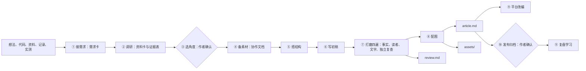

# 架构与设计选择

ai-knowledge 是由宿主 Agent 执行的指令包，没有独立生成进程、模型 API、数据库或后台服务。只安装 `skills/ai-knowledge/` 即可工作。

研究产出的证据表原样进入 review.md；article.md 只承载要发表的正文。两者从同一份研究派生，但读者不同，所以分成两个文件。完整流程设计见 [内容创作工作流](content-workflow.md)。

## 为什么从写稿工具改成创作工作流

v0.4.0–v0.6.0 从输入直接写到交付，中间不停。实际使用中，最常见的返工不是句子不好，而是方向不对：角度不是作者想要的，或者文章需要作者的实测和经历，AI 却只能用公开资料凑。v0.7.0 把作者的判断放回流程里：选角度时停一次，需要实测或经历时列一份任务单，作者回填后再写；内容类型从按输入分（功能、概念、问题）改成按读者要什么分（讲解、复盘、测评、观点），测评和观点有各自的调研方法和阻断项。

内容也从代码项目里搬出来，放进作者的内容工作台。目录组织参考了一位创作者公开分享的写作 Skill：工作台根目录放作者自己维护的人设、风格参考、写作技巧和规范指南，`我的项目/` 下按流程和平台分目录。这样资料卡可以跨文章复用，作者自己的规范优先于 Skill 的通用版本，发布后的项目统一归档。

## 为什么从三稿改成一篇文章

v0.1.0–v0.3.0 每个主题交付知识笔记、发布文章和复习卡片三份稿件。实际使用中暴露了三个问题：

- 精力被三份稿件摊薄，发布文章只是其中之一，质量上限受限于"一次写三份"。
- 核验日期、草稿状态、审批说明混进了正文，复制到平台前要手工删除。
- 证据表留在笔记里，没有固定格式，独立复查无从下手。

v0.4.0 只交付一篇可以直接发表的 article.md，把所有生产信息集中到 review.md，并要求证据表使用固定表头和核验状态。写稿者自己整理的结论只能标"未核验"，留给新会话、子 Agent 或作者本人复查。

## 资源职责

| 文件 | 职责 | 加载时机 |
| --- | --- | --- |
| SKILL.md | 11 步流程、四种内容类型、三种协作强度、优先级与红线 | 命中技能时 |
| 发布合同.md | 工作台查找与目录、文件名、两份 frontmatter、review.md 固定章节、证据类型、归档 | 写入与交付时 |
| 用户人设-快速参考.md | 工作台 用户人设.md 的读法和边界 | ① 接需求、⑥ 写作 |
| 调研-讲解.md / 调研-复盘功能.md / 调研-复盘故障.md / 调研-测评.md / 调研-观点.md | 各类型的证据收集方法和类型专属的阻断项 | ② 对应类型 |
| 调研-资料卡.md | 资料卡的格式、有效期和复用 | ② 有工作台时 |
| 选题与角度.md | 角度方案、核心判断、方案评估、选题库 | ③ |
| 协作文档与真实经历.md | 作者任务单、经历问题、未回填时的写法 | ④ |
| 写作技巧-金字塔原理.md | 结论先行、分组、SCQA、小标题 | ⑤ |
| 内容写作技巧.md / 偏航句用法.md | 读者、标题、开头、段落、版式、转折 | ⑥ |
| 风格-加载.md / 风格-应用.md | 个人规则与工作台风格资料的加载顺序、冲突处理 | ⑥ |
| 打磨与核验.md | 四遍打磨、阻断项、公开安全过滤、独立复查 | ⑦ |
| 降AI味指南.md | AI 味模式、改法、节奏；不以过检测为目标 | ⑦ 文字遍 |
| 自媒体防限流指南.md | 平台规则、AI 内容标识、广告标识；区分有依据的规则和传言 | ⑦ 文字遍、⑨ |
| 视觉-品牌加载.md / 视觉-美术方向.md / 视觉-配图验收.md | 品牌选择、审美方法、出图、台账与检查 | ⑧ |
| 平台改编.md / 口播引导话术.md / 自媒体动画.md | 各平台写法、口播钩子与合规结尾、画面和动效 | ⑨ |
| 运营沉淀.md | 发布数据的记录、比较和写回 | ⑪ |
| 风格-改稿复盘.md / 风格-分析.md / 风格-写回.md | 初稿/终稿复盘、多篇风格分析、个人风格写回 | ⑪ 用户请求时 |
| 视觉-建立品牌.md | 用一张人物图建立视觉品牌 | 用户发图并明确要求时 |
| templates/ | 需求卡、协作文档、资料卡、用户人设、文章、核验、口播稿、出图说明及风格档案、规则、复盘、经历模板；`brand/` 下是视觉品牌的四个模板 | 写对应产物时 |
| scripts/ | 可选辅助：create_project.py、save_article.py（只建目录、移动目录，不覆盖）；analyze_style.py、style_learning.py、visual_assets.py（只读） | 可选，Python 3.10+ 标准库 |

每个参考文档的来源都写在文末，带访问日期；查不到出处的经验值就地标为经验值，平台规则区分官方原文和二手转述。

## 个人配置不随包分发

个人写作规则和视觉品牌是作者的私有资产，放在 Skill 之外的个人配置目录：用户明确给出的路径 → 环境变量 `AI_KNOWLEDGE_PERSONAL` → 主目录下的 `.ai-knowledge/personal/`。都没有时用公共技法和通用图解。

视觉品牌只有一种格式：`brand-kit.json` 加 character.md、style.md、provenance.md 和 `assets/`。旧版一个品牌有十几份规范、提示词和模板，内容互相重复，还和 Skill 里的通用配图规则重叠；合并后，解释图只需读 brand-kit.json 和 style.md，画人物时再读 character.md，读得少也更不容易漏掉约束。品牌和每张图都有"待确认 / 已确认"两种状态，草稿品牌不会被自动使用，避免一张未经确认的图悄悄改变所有文章的配图。用一张图建立品牌的流程见 [建立视觉品牌](../skills/ai-knowledge/references/视觉-建立品牌.md)：只有"图片 + 明确要求"同时出现才启动。

这样分有三个好处：Skill 可以公开分享而不带出私人资料；风格学习写回个人目录，下次调用就生效，不用重装 Skill；每个使用者只会用到自己的配置。代价是换电脑时要自己带上这个目录，可以把它放进一个私有仓库，再用环境变量指过去。仓库校验器会在 skills/ 或 examples/ 里重新出现个人配置时报错。

## 输出合同

有内容工作台时写到 `我的项目/公众号写作/<YYYYMMDD>-<topic-slug>/`，没有时写到用户当前项目的 `docs/knowledge/<topic-slug>/`，都包含 article.md、review.md 和 assets/。用户说"不要图"时没有 assets/。完整规则见 [发布合同](../skills/ai-knowledge/references/发布合同.md)。

几个容易被问到的取舍：

- **article.md 不写一级标题。** 标题在平台里单独填写，正文从封面图开始。
- **正文不放 Mermaid。** 公众号、X、小红书都不渲染 Mermaid，图解一律导出成 PNG，SVG 留作可编辑源。
- **外链集中在文末。** 公众号正文外链通常不可点击，读者需要能看到地址。
- **平台改编另写文件。** 小红书、微博的阅读方式不同，改编是重新组织而不是缩写；主稿不动。
- **目录冲突新建带序号的相邻目录。** 只有用户明确要求更新时才在原目录修改，并保留 created。
- **需求卡和协作文档是普通 Markdown。** 它们给作者看、给作者填，不做机器校验，避免为中间产物维护协议；需要校验的只有 article.md、review.md 和配图台账。

提纲写进需求卡的角度方案，不单独存文件。

## 校验能做什么、不能做什么

`tests/validate.py` 检查两份文件的 frontmatter、review.md 的固定章节和证据表枚举值、图片链接与台账、正文中的生产信息字样，以及有限的敏感模式（JWT、Bearer 令牌、私有 IPv4 等）。`scripts/visual_assets.py` 检查资源闭包、路径边界、图片尺寸与哈希、SVG 自包含和审批状态。

它们只证明结构与台账一致。事实是否正确、内容能否公开、文章是否好读，仍然依赖打磨四遍里的独立复查和作者判断。

## 可迁移性边界

Skill 不依赖 Codex 专用 API。文件读取、联网、写文件、生图和浏览器渲染都依赖宿主提供的能力。没有联网时报告核实限制；没有写权限时在对话里交付完整正文；没有生图工具时做程序化图解，人物图记为待制作。兼容 Agent Skills 标准不等于已在所有宿主中实测，具体结果见 [测试报告](../tests/RESULTS.md)。

## 版本沿革

- v0.1.0：三种模式与三稿合同。
- v0.2.0：可选的风格分析与个人档案，见 [验收说明](v0.2.0-acceptance.md)。
- v0.2.1：个人写作规则与文章复盘。
- v0.3.0：视觉品牌、视觉计划与资产检查。
- v0.4.0：改为一篇可发表文章加发布前核验记录，默认配图；个人配置移出 Skill，放到使用者自己的目录。
- v0.5.0：视觉品牌精简为四个文件；支持用一张人物图建立品牌、按名字选用品牌，草稿确认后才自动使用。
- v0.6.0：审美方法论进入公共 Skill（美术方向、出图说明模板、视觉语言、四图测试、风格样板）；生图工具可以写短标题但必须逐字核对，数据图比例必须核实。
- v0.7.0：改为 11 步内容创作工作流；内容类型改为讲解、复盘、测评、观点；三种协作强度；内容工作台；新增调研、写作、打磨、平台改编和运营的参考文档与模板；参考文档改为中文文件名，模板移到 `templates/`。

审美方法放在公共 Skill，具体答案放在各自的品牌里：方法对任何角色都适用，换一个新角色只需要填自己的材质、主色和签名图形；某个品牌的颜色和图形写进公共规则，所有人的图就会长得一样，也会带出私有资产。

历史验收记录中提到的已删除文件保留为纯文本路径。
