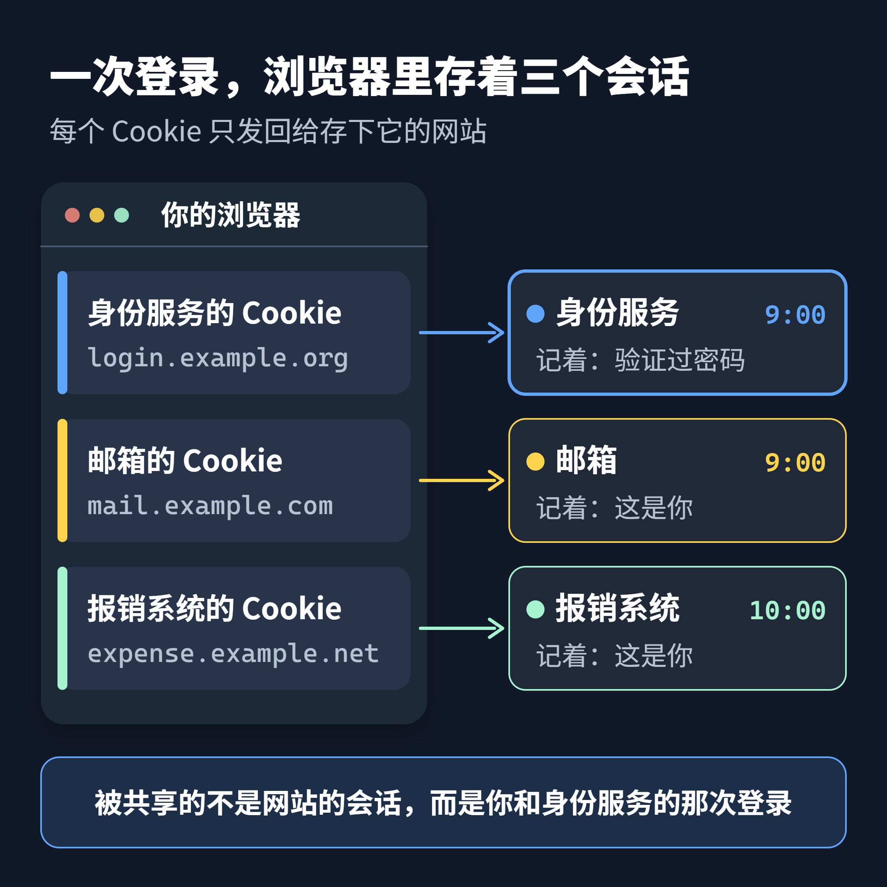
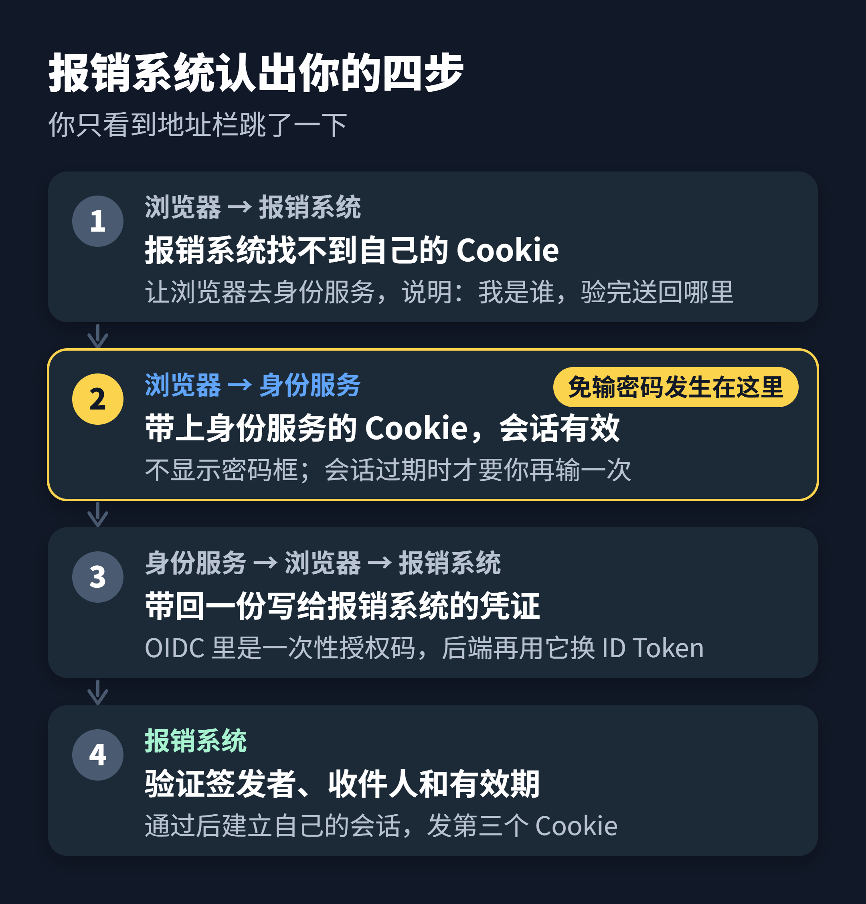
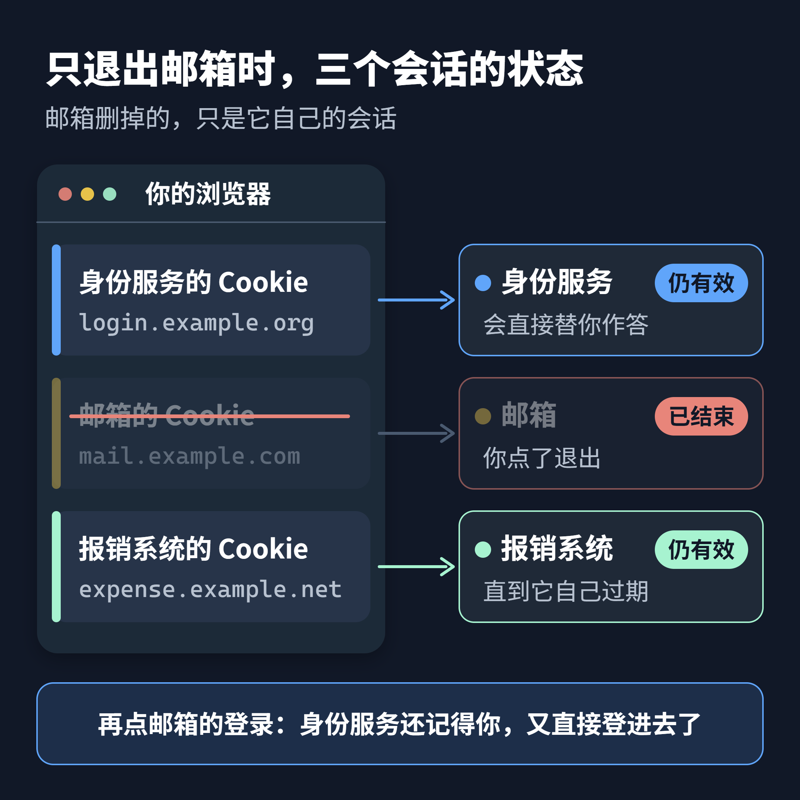

早上九点，你打开公司邮箱，输了一次密码。十点打开报销系统，它没要密码，右上角直接显示了你的名字。

这两个系统由不同的团队开发，域名也不一样，一个是 `mail.example.com`，一个是 `expense.example.net`。浏览器的规则是：一个网站存下的 Cookie，只会发回给这个网站。报销系统看不到邮箱的 Cookie，也就无从知道你早上登录过。

那它是怎么认出你的？答案有点反直觉：报销系统其实也登录了一次，只是这一次不用你动手。它把你送到公司的身份服务，问了一句「这是谁」。身份服务还记得你早上那次登录，于是马上回答。整个过程一两秒，你只看到地址栏闪了一下。

单点登录（Single Sign-On，SSO）省掉的是重复输入密码，没有省掉每个网站自己的登录。读完这篇，你能说清这一两秒里发生了什么，为什么凭证不能拿去别的网站用，以及为什么退出登录反而是最难的部分。

## 一次登录，背后是三个会话

先说清「会话」。网站记住你的办法，是在你登录成功后给浏览器发一个 Cookie，里面通常是一串随机编号。之后每次访问，浏览器都带上它，网站凭这串编号查到你是谁。这一套就叫会话。

单点登录里有三方：你的浏览器、各个业务网站，以及身份服务（Identity Provider，常简称 IdP）。身份服务是唯一知道你密码的地方，邮箱和报销系统都不保存你的密码。

早上九点那次登录结束时，浏览器里其实存了两个 Cookie。一个属于身份服务，记着「这个浏览器验证过密码」；一个属于邮箱，记着「这是你」。十点打开报销系统之后，还会多出第三个。

关键在身份服务那一个。它存在身份服务自己的域名下，所以无论你从哪个网站被送过来，浏览器都会把它带给身份服务。单点登录能成立，靠的就是这一点：被共享的不是哪个网站的会话，而是你和身份服务之间的那一次登录。

## 报销系统认出你的那一两秒

把十点打开报销系统的过程放慢，可以分成四步。

1. 报销系统在请求里找不到自己的 Cookie，判断你还没登录。它让浏览器跳转到身份服务，并在地址里说明两件事：我是谁，验证完把人送回哪里。
2. 浏览器来到身份服务，带上了早上存下的身份服务 Cookie。身份服务一查，会话还有效，于是不再显示密码框。
3. 身份服务签发一份只给报销系统用的凭证，让浏览器带着它跳回报销系统。
4. 报销系统验证这份凭证：是不是身份服务签发的，是不是写给自己的，有没有过期。通过之后，它创建自己的会话，给浏览器发第三个 Cookie。

从你的角度看，只是地址栏跳了一下。从报销系统的角度看，它完整地走了一遍登录，只是用身份服务的回答代替了密码框。如果早上那次登录已经过期，第 2 步就会出现密码框，你再输一次密码，其余步骤照常进行。

第 3 步的凭证，在不同协议里长得不一样。在 OpenID Connect（OIDC）里，浏览器带回的只是一个一次性的授权码，报销系统的后端再拿着它，从服务器直接向身份服务换取 ID Token。ID Token 是一份带数字签名的身份声明，写着你是谁、由谁签发、写给哪个网站。在 SAML 里，浏览器直接带回一份签名的断言。细节不同，骨架一样：网站不碰你的密码，只验证身份服务的签名。

## 凭证上写着收件人

报销系统拿到的凭证，能不能拿去邮箱用？不能。OIDC 的 ID Token 里有一个收件人字段 `aud`，写着它签发给哪个网站，规范要求每个网站都检查这个字段里有没有自己。

这有点像公司前台。你早上在前台出示过工牌，前台记住了你。之后你去哪个部门，部门都先打电话问前台「来的是谁」，前台就给这个部门单独开一张写着部门名字的条子。财务部只认写着财务部的条子，拿着开给行政部的条子去财务部没用。

这个类比在两个地方不成立。现实里的条子可以伪造，网上的凭证靠身份服务的数字签名防伪，网站用身份服务公开的密钥验签。另外，条子是经过你的手转交的。正因为浏览器这一程不够可靠，OIDC 才让浏览器只带一个一次性的码，真正的身份声明走服务器之间的通道。

收件人检查不能省。假设报销系统偷懒不检查，那么任何一个接入同一身份服务的网站，包括一个不怀好意的网站，都可以拿着你登录它时得到的凭证，冒充你登录报销系统。

## 身份服务说你是谁，不说你能做什么

单点登录解决的是认证，也就是确认「你是谁」。你能不能审批报销、能看哪些单据，属于授权，仍然由报销系统自己决定。身份服务可以在凭证里附带部门、角色这类信息，但用不用、怎么用，是每个网站的事。

把所有登录集中到一处，也意味着身份服务成了所有系统共用的一把总钥匙。一个账号的密码被盗，所有接入的系统都会敞开。所以多因素认证最该加在身份服务上，而不是分散在每个网站里。

## 退出登录为什么最难

回到那三个会话。你在邮箱点了退出，邮箱删掉的只是它自己的会话。身份服务的会话和报销系统的会话会不会跟着结束，取决于这几个系统有没有接入单点登出。

如果都没接，会出现一个让人困惑的现象：你刚退出邮箱，再点一次邮箱的登录，它又自动登进去了。原因是身份服务的会话还活着，它像十点时那样直接替你作了答。

OIDC 为单点登出准备了几种机制：网站把你送到身份服务注销（RP-Initiated Logout），身份服务在浏览器里逐个通知各网站（Front-Channel Logout），或者身份服务从服务器直接通知各网站（Back-Channel Logout）。浏览器里的通知要借助隐藏页面逐个加载各网站，浏览器限制第三方 Cookie 后可能送不到；服务器之间的通知要求每个网站能接收身份服务的请求，并找到对应的会话。哪一种都需要每个网站额外接入，这也是很多系统只做到「退出当前网站」的原因。

## 下次再遇到「免登录」

遇到任何一个看起来自动登录的系统，问三个问题：

- **记住你的是谁？** 找出身份服务的会话和网站自己的会话，它们各自独立，各有各的有效期。
- **凭证写给了谁？** 每个网站只接受写着自己名字的凭证，并且自己验证签名。
- **退出时谁还不知道？** 没有接入单点登出的会话，会一直活到它自己过期。

回到开头。报销系统认得你，不是因为它看到了邮箱的 Cookie，而是因为它也去问了身份服务，而身份服务还记得你。

## 参考

- OpenID Connect Core 1.0：https://openid.net/specs/openid-connect-core-1_0.html
- RFC 6265 HTTP State Management Mechanism：https://www.rfc-editor.org/rfc/rfc6265
- OpenID Connect RP-Initiated Logout 1.0：https://openid.net/specs/openid-connect-rpinitiated-1_0.html
- OpenID Connect Front-Channel Logout 1.0：https://openid.net/specs/openid-connect-frontchannel-1_0.html
- OpenID Connect Back-Channel Logout 1.0：https://openid.net/specs/openid-connect-backchannel-1_0.html
- SAML 2.0 Technical Overview：https://docs.oasis-open.org/security/saml/Post2.0/sstc-saml-tech-overview-2.0.html
