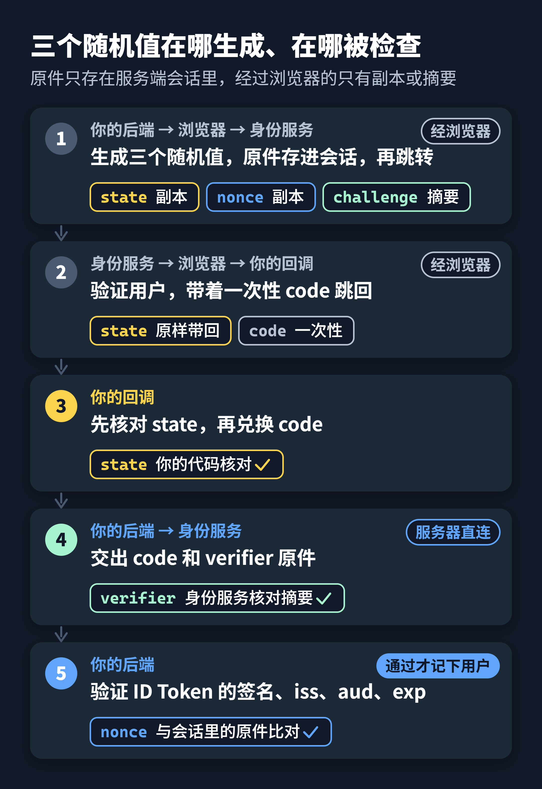
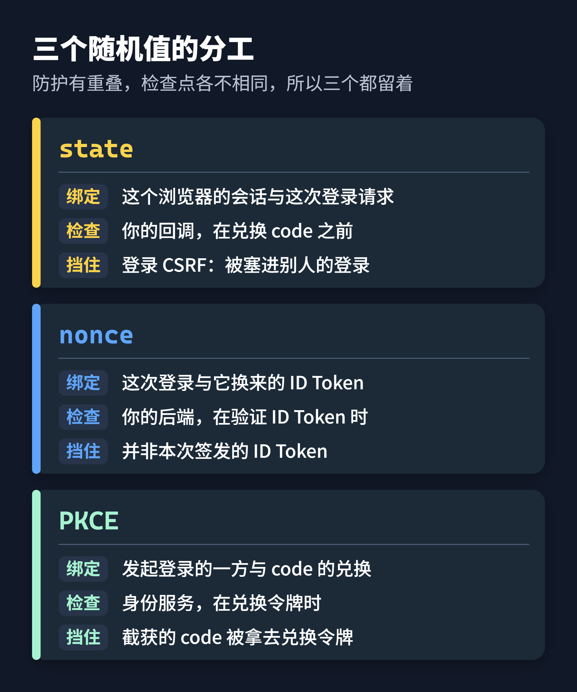

假设你刚给网站接好统一登录：点击登录，跳到身份服务，输入密码，跳回来，页面上出现了你的名字。功能看起来完成了。

再看一眼发往身份服务的那个地址。除了 `client_id` 和回调地址，还有三个看不出用途的随机值：`state`、`nonce` 和 `code_challenge`。在 OIDC 的授权码流程里，规范并不强制你传 `state` 和 `nonce`；`code_challenge` 背后的 PKCE 是否强制，取决于身份服务的配置。三个都不传，登录很可能照样成功。

正因为不传也能成功，它们最容易被省掉，测试也发现不了。可每一个都在挡一种具体的冒充：

- `state` 确认回到你网站的，是这个浏览器发出去的那次登录；
- `nonce` 确认后端拿到的 ID Token，是为这次登录签发的；
- PKCE 确认拿授权码来兑换令牌的，是当初发起登录的那一方。

下面用一段 75 行的 Python 演示把这三件事讲清楚。演示是为本文原创的教学代码，省略了网络请求和签名校验，配有用假身份服务跑通的单元测试。换成 Java 或 Go，写法不同，要检查的点一样。

## 先看一次完整的登录

一次 OIDC 授权码登录，可以拆成五步：

1. 用户点击登录。后端生成三个随机值，存进这个浏览器对应的服务端会话，再把用户送去身份服务。
2. 身份服务验证用户，然后让浏览器带着一个一次性的授权码 `code` 和原样的 `state` 跳回你的回调地址。
3. 回调先核对 `state`，对不上就到此为止。
4. 后端带着 `code` 和随机值 `verifier` 的原件，从服务器直接向身份服务兑换令牌；身份服务核对 `verifier` 和当初的摘要是否对得上。
5. 后端检查拿到的 ID Token：签名、签发者、收件人、有效期，以及里面的 `nonce`。全部通过，才在会话里记下这个用户。



图里最该注意的是：三个随机值都在第 1 步生成，原件存在服务端，和这个浏览器的会话绑在一起。攻击者能摆弄的，是经过浏览器的那些东西，比如地址栏里的 `code` 和 `state`；他拿不到的，是你服务端会话里存的原件。

演示里的 `begin` 就是第 1 步：

```python
def begin(self, browser_session: dict) -> str:
    state, nonce, verifier = (secrets.token_urlsafe(32) for _ in range(3))
    browser_session["pending"] = (state, nonce, verifier)
    challenge = base64.urlsafe_b64encode(
        hashlib.sha256(verifier.encode("ascii")).digest()
    ).rstrip(b"=").decode("ascii")
    return self.config.authorization_endpoint + "?" + urlencode({
        # client_id、redirect_uri、response_type、scope 已省略
        "state": state,
        "nonce": nonce,
        "code_challenge": challenge,
        "code_challenge_method": "S256",
    })
```

第 2 行生成三个随机值，第 3 行把它们原样存进服务端会话。注意 `verifier` 本身不出门，发给身份服务的是它的 SHA-256 摘要 `challenge`。

## state：回来的是不是你发出去的那次登录

先看没有 `state` 时会发生什么。攻击者用他自己的账号，在你的网站上发起一次登录，在身份服务输完他的密码，拿到跳回你网站的那个地址，里面带着他的 `code`。他不打开这个地址，而是把它藏进一个链接，诱导你点开。

你的浏览器带着他的 `code` 访问了回调，网站用这个 `code` 换到了他的身份。于是你被登录成了攻击者。之后你在这个账号里上传的文件、填写的地址、绑定的支付方式，攻击者都能看到。这种攻击叫登录 CSRF。

`state` 的作用，就是让回调能分辨「这是不是我发出去的那次登录」：

```python
def callback(self, browser_session: dict, code: str, state: str) -> Identity:
    pending = browser_session.pop("pending", None)
    if pending is None or not secrets.compare_digest(pending[0], state):
        raise ValueError("invalid or consumed login state")
```

攻击者的 `code` 是跟着他自己那次登录来的，地址里的 `state` 也是他那次的值。你的会话里要么没有待完成的登录，要么存的是你自己那次的 `state`，比对不上，回调在兑换 `code` 之前就停了。

这三行里还有两个细节。第 2 行用的是 `pop`，取出的同时就删掉，同一个回调地址打开第二次会失败，单元测试 `test_callback_cannot_be_replayed` 专门验证了这一点。第 3 行用 `compare_digest` 做恒定时间比较，比较秘密值时这是一个几乎零成本的好习惯。

## nonce：这张 ID Token 是不是为这次登录签发的

`nonce` 会被身份服务原样写进 ID Token。后端验证签名之后，再比对令牌里的 `nonce` 和会话里存的是否一致。

它挡住的，是一张并非为这次登录签发的 ID Token。可能是之前在别处泄露的旧令牌，也可能是攻击者用他自己那次登录换来的令牌。这种令牌签名是真的，签发者是真的，收件人也对，只有 `nonce` 对不上。

演示没有自己写这一步，而是把它写进一个接口约定，交给真正的 OIDC 库完成：

```python
class OidcAdapter(Protocol):
    def exchange_and_validate(self, code: str, verifier: str,
                              nonce: str, config: Config) -> Identity:
        """Exchange code with PKCE; verify signature, issuer, audience, expiry,
        nonce and protocol requirements using a maintained OIDC library.
        Raise on failure. Returning decoded but unverified claims violates
        this contract. This fixture does NOT implement the adapter.
        """
```

注释里那句「解码但没验证的声明违反约定」，对应一个常见错误：把 ID Token 中间那段 Base64 解开，直接读里面的用户信息。那段内容谁都能编，只有验过签名、核对过签发者 `iss`、收件人 `aud`、有效期 `exp` 和 `nonce` 之后，它才是可信的身份。签名校验不要手写，交给维护良好的库。

## PKCE：拿到 code 的人，不一定换得到令牌

`code` 跟着浏览器的地址栏走了一趟，可能留在浏览器历史或代理日志里。在手机上，恶意应用甚至可能注册同一个回调地址，把 `code` 直接截走，这正是 PKCE 最初要解决的问题。

PKCE 的做法是：发起登录时生成 `verifier`，原件留在服务端，只把它的摘要 `challenge` 交给身份服务。兑换 `code` 时必须交出 `verifier` 原件，身份服务重新算一遍摘要，对得上才发令牌。摘要推不回原件，所以只截到地址栏里那些东西的人，换不到令牌。

回头看 `begin` 的第 4–6 行，摘要用的是 SHA-256，对应参数 `code_challenge_method` 为 `S256`。PKCE 还允许一种 `plain` 方式，等于把 `verifier` 原样发出去，保护就没了。规范要求客户端只要能用 `S256` 就必须用它。

## 三个值有重叠，为什么都要留着



三者的防护确实有重叠。2025 年发布的 OAuth 安全最佳实践 RFC 9700 承认，在身份服务确实支持 PKCE 时，PKCE 本身就能防住 CSRF；在 OIDC 流程里，`nonce` 也能起到同样的作用。理论上，你可以只留其中一部分。

我的建议是三个都留着。它们的检查点不在同一个地方：`state` 在你自己的回调里第一时间拦截，不依赖任何外部实现；PKCE 的校验发生在身份服务那边，效果取决于它的实现和配置；`nonce` 的检查依赖你的令牌验证代码确实比对了这个字段。多传三个随机值的代价，只是登录地址长了一百多个字符，换来的是任何一处出问题时，还有另外两道防线。

## 登录成功之后，还有两件事

**用 `iss` 加 `sub` 认人，不用邮箱。** OIDC 规定，签发者 `iss` 和用户标识 `sub` 组合起来，才是能长期依赖的用户身份。邮箱会变，也不保证唯一。演示在保存用户前先核对签发者，然后存下这一对值：

```python
if identity.issuer != self.config.issuer or not identity.subject:
    raise ValueError("invalid identity returned by adapter")
# A real HTTP integration must rotate the session identifier here.
browser_session["user"] = (identity.issuer, identity.subject)
```

**登录后换一个新的会话 ID。** 如果攻击者事先让你的浏览器用上一个他知道的会话 ID，而你登录后网站没有换掉它，他就能拿这个 ID 以你的身份访问。这叫会话固定。演示只是一个流程类，没有 HTTP 层，所以在第 3 行留下了注释；接进真实的 Web 框架时，这一步要用框架提供的方法完成。

## 用五个问题检查你的登录回调

1. 跳转前，`state`、`nonce`、`verifier` 是否存在服务端会话里，并且和当前浏览器绑定？
2. 回调时，是否先核对 `state` 再兑换 `code`？核对之后是否立刻作废，不能用第二次？
3. ID Token 是否由成熟的库验签，并核对了 `iss`、`aud`、`exp` 和 `nonce`？
4. `code_challenge_method` 是不是 `S256`？
5. 用户标识是不是 `iss` 加 `sub`？登录成功后是否换了会话 ID？

这五个问题只覆盖回调这一段。回调地址的精确匹配、全程 HTTPS、令牌的存放和退出登录，是另外的话题。五个都答「是」，你的登录就不只是能跑通。

## 参考

- OpenID Connect Core 1.0：https://openid.net/specs/openid-connect-core-1_0.html
- RFC 6749 The OAuth 2.0 Authorization Framework：https://www.rfc-editor.org/rfc/rfc6749
- RFC 7636 Proof Key for Code Exchange by OAuth Public Clients：https://www.rfc-editor.org/rfc/rfc7636
- RFC 9700 Best Current Practice for OAuth 2.0 Security：https://www.rfc-editor.org/rfc/rfc9700
- 本文演示代码与单元测试：ai-knowledge 仓库 `tests/fixtures/oidc-demo/login.py`、`tests/test_oidc_demo.py`（MIT 许可）
